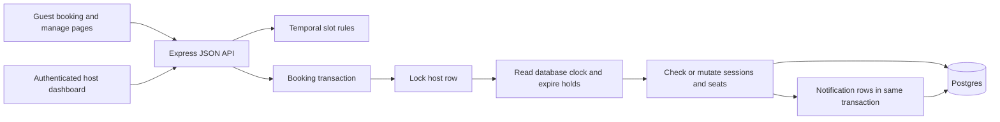
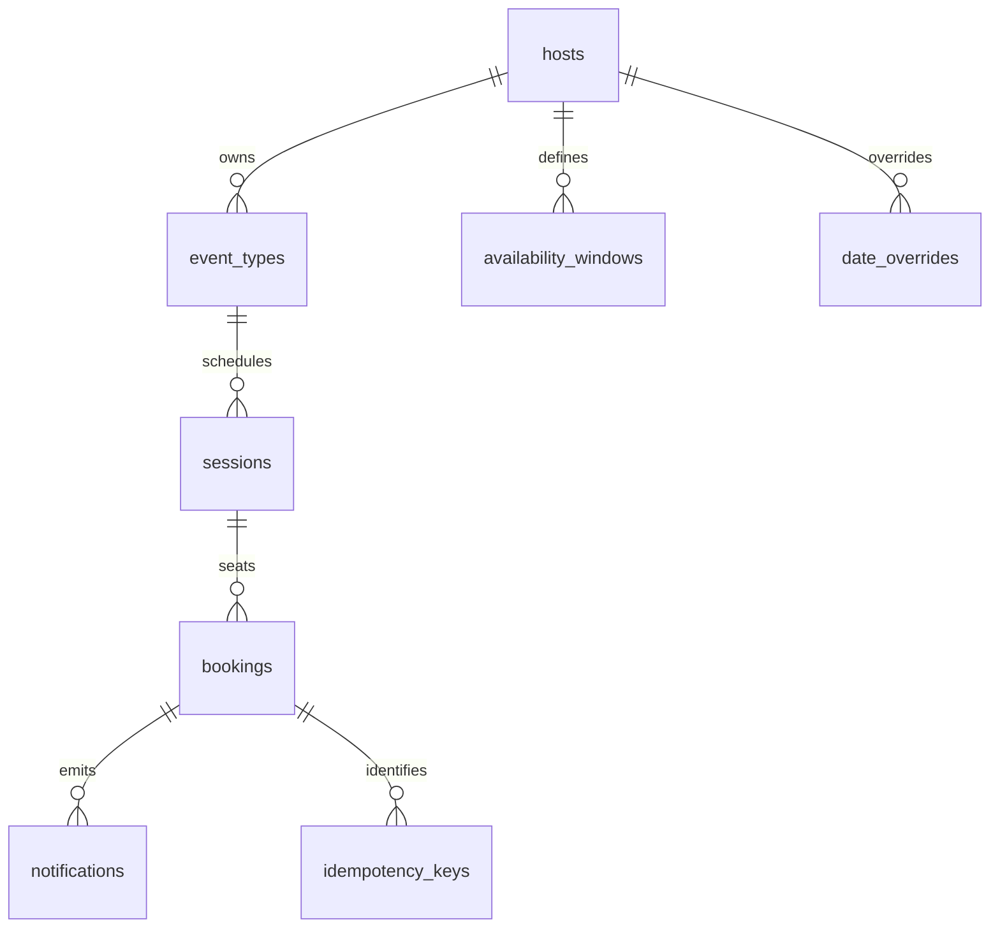

# Architecture and reliability

Slotbook has one React browser app, one TypeScript Express API and one Postgres database. The host dashboard and public booking pages use the same API. Postgres holds both the booking records and the notification sink, so a successful lifecycle change cannot commit without its notification record.

`server/index.ts` contains routing, request validation, signed host sessions and observability. `server/host.ts` handles availability and event configuration. `server/slots.ts` converts host-local rules into real instants. `server/booking.ts` implements lifecycle operations. `server/db.ts` owns the shared transaction protocol. `migrations/001_init.sql` defines the database constraints. The migration and seed run on application startup.

## Data model

| Table                  | Important columns and constraints                                                                            |
| ---------------------- | ------------------------------------------------------------------------------------------------------------ |
| `hosts`                | ID, unique slug, name, IANA `time_zone`; its row is the serialization point                                  |
| `event_types`          | Host, slug, elapsed duration, capacity, buffers, notice, horizon; per-host unique slug and numerical bounds  |
| `availability_windows` | Host, ISO weekday, start/end minute; multiple non-overlapping windows validated by API                       |
| `date_overrides`       | Host + local date primary key; JSON windows replace that date's weekly rules; empty array means day off      |
| `sessions`             | One occurrence: host, event, start/end instants, capacity snapshot, buffered `tstzrange`, `active` flag      |
| `bookings`             | UUID capability, session, numbered seat, lifecycle status, expiry, guest details, manage-token hash, version |
| `idempotency_keys`     | Host + operation + key primary key, normalized request, booking reference and optional saved response        |
| `notifications`        | Booking, version, kind, payload; unique booking/version/kind prevents duplicate event records                |

The `no_host_overlap` exclusion constraint rejects overlapping active session ranges for a host, including overlaps between different event types. The half-open range `[start,end)` includes the before/after buffers: two ranges touching at a boundary do not overlap.

Group attendees share one occurrence only when event type, start and end match. They receive numbered seats. A partial unique index prevents two held/confirmed bookings occupying the same seat; a check bounds the seat number; a composite foreign key binds the copied capacity to its session. Together these prevent capacity from being increased merely by inventing a bigger capacity on a booking row.

An active session remains occupied while it has held or confirmed attendees. Canceled and expired bookings retain history but release their seats. The application updates the session's `active` flag under the same host lock. **That lifecycle protocol remains necessary**: constraints alone do not prevent an administrator from deactivating a populated session or rewriting status directly.

## Booking transaction

1. Begin a transaction and `SELECT ... FROM hosts ... FOR UPDATE`.
2. After obtaining the lock, read `clock_timestamp()` from Postgres. Expire due holds and deactivate now-empty sessions.
3. Create a savepoint. Validate idempotency and the requested operation; resolve availability using the locked configuration.
4. Reserve or move a seat and write any notification record.
5. Commit. On failure, roll back to the savepoint, retain terminal expiration, commit that cleanup, and return the error.

Read committed isolation is sufficient for this protocol because competing writers to one host must acquire the same database row lock before inspecting capacity. Once a waiter acquires it, its subsequent statements see the preceding committed changes. Different hosts can proceed independently. Slot listings and the dashboard use the same helper for lazy expiration. Slot availability remains advisory: it is validated again when a hold is created.

**Hold:** the idempotency key binds the event and canonical start instant. An existing matching key returns the same hold; different input returns a conflict. A new hold allocates one seat and a deadline five minutes after database time.

**Confirm:** expired state is rejected. Otherwise the held seat changes to confirmed, guest details and a manage-token hash are stored, and a notification row is inserted. A matching retry returns the same derived manage token; different guest details cannot overwrite the first confirmation.

**Reschedule:** only confirmed bookings move. The old seat is released inside the transaction, and its occurrence is deactivated only if no other attendee remains. The replacement is validated and reserved, then the same booking is updated and an event recorded. A conflict rolls the release back. This permits a booking to move across its own old buffer while preserving occupancy for other group attendees. The capability-protected reschedule slot endpoint previews availability after hypothetically removing only this booking. Other attendees continue to occupy their group session; the preview never releases the actual booking. Reschedule retries return the saved response without moving again; fetch the current booking if later changes may have occurred.

**Cancel:** a guest capability or authenticated host authorizes cancellation. The seat is released, an empty occurrence is deactivated and one notification is recorded. Repeating the cancellation does not emit another event.

Manage tokens are deterministic HMAC values derived from the booking UUID and a persistent server secret; only their SHA-256 hashes are stored in the database. The hold UUID is also a private capability. Neither should be logged or shared. Host authentication is a seeded demonstration login, not a multi-tenant identity system.

## Seven consequential choices

| Choice                                          | Alternative considered                                       | Reason and tradeoff                                                                                                                                          |
| ----------------------------------------------- | ------------------------------------------------------------ | ------------------------------------------------------------------------------------------------------------------------------------------------------------ |
| Per-host Postgres row lock                      | Process-local mutex, external lock, or finer session locks   | Works across API processes and protects cross-event overlap. One busy host is intentionally serialized; measure contention before splitting the lock domain. |
| Session ranges plus numbered seats              | Count bookings alone or exclude every attendee range         | A group needs shared occupancy. Constraints separately express host overlap and per-session capacity.                                                        |
| Database time after acquiring the lock          | Browser time, application time, or transaction-start `now()` | A request may wait past its deadline. The authoritative time must be sampled after that wait.                                                                |
| Terminal expiry retained through a savepoint    | Time-dependent index or rollback of all cleanup              | Index membership must be explicit state. Observed expiration must not reverse when time later moves backward.                                                |
| Transactional idempotency and notification rows | In-memory request cache or network send during booking       | A lost response can be retried after restart; event creation and booking changes commit together. Real delivery would require a separate worker.             |
| IANA wall-time rules plus UTC instants          | Fixed UTC weekly hours or fixed offsets                      | Recurring host availability follows local daylight saving rules; guest formatting never changes the booked instant.                                          |
| Small React/Express/plain-SQL app               | More services, ORM abstraction or external scheduling system | The correctness path remains visible during the interview. Built-in Postgres mechanisms handle coordination.                                                 |

## Time-zone policy

Weekly windows and date overrides describe local calendar time in the host's IANA zone. The generator walks host-local dates and applies an override in place of weekly availability. Each window supplies a grid whose step equals the event duration. The generated start is converted to an instant, and the meeting ends after its real elapsed duration. The appointment must fit inside its availability window; buffers protect host occupancy but may extend outside that window.

A nonexistent spring-forward start is skipped after a wall-time round-trip check. An ambiguous autumn start chooses the earlier occurrence once. Window end boundaries resolve with the later policy. This is an explicit product choice, not a universal calendar rule. The booking horizon is measured by adding host-local calendar days to database time; minimum notice is elapsed minutes.

Worked example: on **8 March 2026**, New York skips from 01:59:59 to 03:00. For a 30-minute event in a 01:00–04:00 window, starts are 01:00 EST, 01:30 EST, 03:00 EDT and 03:30 EDT, corresponding to 06:00Z, 06:30Z, 07:00Z and 07:30Z. The missing 02:00 and 02:30 are never silently shifted. Each meeting still lasts 30 real minutes. A guest in Kolkata sees the same instants as 11:30, 12:00, 12:30 and 13:00.

On **1 November 2026**, New York's 01:30 repeats. This implementation offers the earlier 01:30, `05:30Z`, once; it does not offer the second `06:30Z` start. The interface includes the time-zone abbreviation when formatting times. Changing guest display zones can also change the displayed date: 09:00 in Kolkata on 9 November is 22:30 in New York on 8 November.

## Failure cases and evidence

The recorded suite passes all 24 tests: 19 real-Postgres tests and five deterministic time-zone tests. See [the captured run](test-results.txt) for the actual output and environment.

| Failure                                           | Response                                                   | Test evidence                                            |
| ------------------------------------------------- | ---------------------------------------------------------- | -------------------------------------------------------- |
| Thirty simultaneous claims for one seat           | One commits; 29 conflict                                   | Concurrency test asserts API outcomes and database count |
| Group contention                                  | Held and confirmed seats share the same bounded capacity   | Capacity-three contention test                           |
| Hold response lost or duplicated                  | Same key recovers one resource; changed input conflicts    | Concurrent retry and payload-binding tests               |
| Confirmation waits past expiry                    | Fresh database time after lock rejects it                  | Queued confirm test also checks persisted expired status |
| Expired deadline later appears in the future      | Terminal status cannot return to held                      | Expiry-resurrection test                                 |
| Application clock wrong                           | Booking deadlines and horizon still use Postgres time      | Clock-skew test                                          |
| Target slot unavailable on reschedule             | Original confirmation survives rollback                    | Failed-reschedule test                                   |
| Move overlaps its own old buffer                  | Atomic release/reserve succeeds                            | Self-overlapping reschedule test                         |
| Another attendee remains in old group             | Old session continues blocking the host                    | Group reschedule conflict test                           |
| Confirmation, reschedule or cancellation repeated | One state transition and one corresponding event           | Retry/notification tests                                 |
| Wrong SQL inserts                                 | Exclusion, uniqueness and capacity foreign key reject them | Direct-constraint test                                   |
| DST gap/fold or date override                     | Documented deterministic generation                        | Five time-zone tests                                     |

A wildly wrong database wall clock can shorten or lengthen a hold and alter which dates satisfy notice/horizon policy. It cannot by itself create another active seat or overlapping occurrence. Expiry is terminal once observed. This separates **booking safety** from exact real-world timing. A database outage returns an error; the app never grants a local fallback booking. Lost commit acknowledgments are resolved by retrying with the same key, not by assuming failure means nothing committed.

## Scope, extension and next day

The optional extension is basic observability: request IDs, JSON logs containing route templates/status/duration, a database-backed health check and authenticated metrics. Guest details and capability URLs are omitted from request logs. Notifications are a table sink with no external delivery queue, so external delivery latency is not measured.

No load benchmark was built: concurrent correctness tests answer the most important safety question within the assignment's scope, but do not establish throughput or p95 latency. With another day, add an HTTP load script and record results, browser E2E tests and CI, rate limits and bot defenses, production identity management, secret rotation and deployment configuration. Real email/webhooks would use an outbox worker with retries and delivery tracking. Multi-host routing, external calendars, reminders and waitlists remain unbuilt.

Other limits: idempotency records have no retention job; session/history scans will need indexing and retention review at larger scale; there is no expiry worker because lazy cleanup is sufficient for correctness; the migration is an initial schema, not a generalized upgrade framework. Host settings affect future slot generation while existing bookings keep their instants. Event type editing/deletion is not exposed. No public deployment or GitHub publication is claimed here.

## Primary references

- [Postgres exclusion constraints](https://www.postgresql.org/docs/15/sql-createtable.html#SQL-CREATETABLE-EXCLUDE) explain the database mechanism used for incompatible host ranges.
- [Postgres date/time functions](https://www.postgresql.org/docs/15/functions-datetime.html#FUNCTIONS-DATETIME-CURRENT) distinguish transaction-start time from `clock_timestamp()`.
- [Temporal time-zone documentation](https://tc39.es/proposal-temporal/docs/timezone.html) describes ambiguous/nonexistent local times and explicit disambiguation policies.
